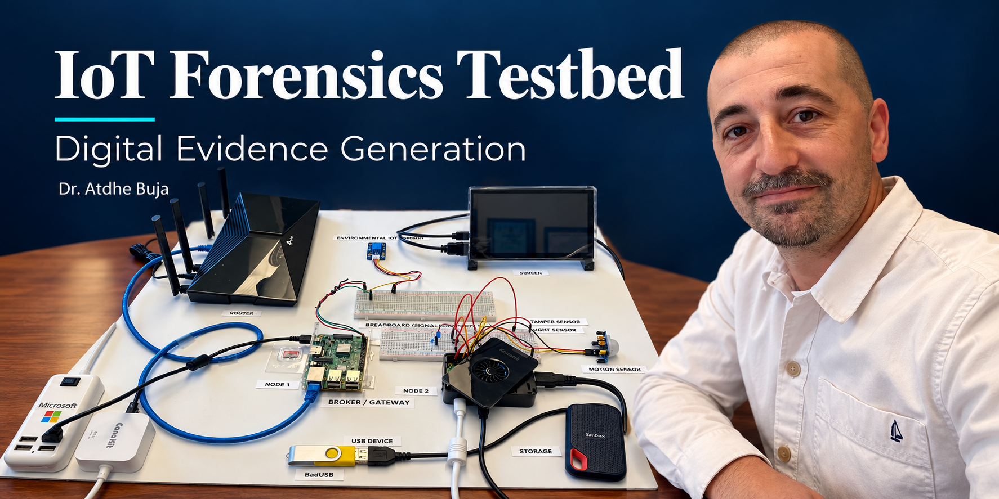
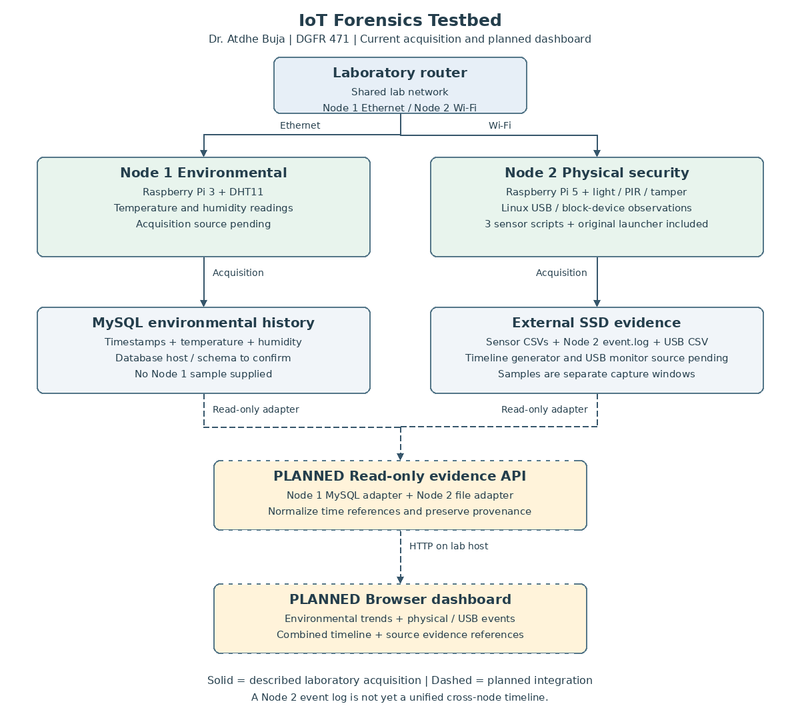
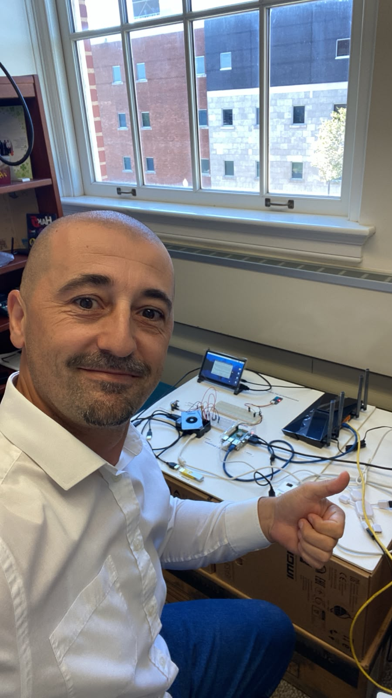

# Digital Forensics and IoT Evidence Generation

## IoT Forensics Testbed



**Designed and implemented by Dr. Atdhe Buja | 2026 | Used in DGFR 471 IoT Forensics**

A two-node Raspberry Pi testbed connecting physical events to investigable digital evidence. Node 1 collects environmental measurements in MySQL. Node 2 records light, motion, tamper-button, and USB activity in filesystem artifacts on external SSD storage. Python acquisition scripts and a Node 2 event timeline support evidence collection and student investigation.

This repository presents my system design, supplied Node 2 acquisition code, selected evidence samples, and three teaching scenarios. It is a portfolio case study and a partial reproducibility release. **The original Node 2 timeline generator and USB monitor have not yet been supplied; the complete launcher cannot run from this repository alone.** Node 1 source and the unified dashboard are also pending.

[Project article](https://www.atdheb.com/iot-forensics-testbed-for-digital-evidence-generation/) · [YouTube teaching demonstrations](https://www.youtube.com/@atdhebuja) · [Website](https://www.atdheb.com) · [GitHub profile](https://github.com/atdhebuja)

## My contribution

I designed the two-node evidence-generation environment, integrated the physical monitoring components and SSD storage, developed the investigation workflow, and prepared DGFR 471 scenario handouts. The project connects technical implementation with evidence interpretation, timeline reconstruction, and explicit limits on forensic conclusions.

Hardware resources for part of this project were funded by the **Department of Math, Computer Science, and Digital Forensics, Commonwealth University of Pennsylvania**. This acknowledgment concerns departmental hardware support; it is not a claim of an external research award.

## Architecture and release status



Solid paths show the described acquisition architecture. Dashed paths show the planned combined dashboard. The current Node 2 timeline is distinct from the future cross-node timeline.

| Component | Implemented laboratory capability | Included in this release |
| --- | --- | --- |
| Node 1 | Raspberry Pi 3, DHT11, MySQL environmental records | Architecture only; source, schema, and export pending |
| Node 2 sensors | Raspberry Pi 5, light, PIR motion, tamper button and indicator LED | Three original sensor scripts and sample CSVs |
| Node 2 timeline | Master event log used by the laboratory | Sample `event.log`; generator source pending |
| USB monitoring | Block-device insertion/removal evidence | Redacted sample CSV; monitor source pending |
| Teaching | Three 50-minute group investigations | Original Word handouts and Markdown transcriptions |
| Offline evidence indexing | New repository support utility | CSV normalization with source hashes; hardware not required |
| Unified dashboard | Planned read-only view across both nodes | Design and acceptance criteria only |

The current owner-provided Node 1 specification is **DHT11**. Earlier descriptions may refer to DHT22; this release follows the current specification. The MySQL host location and schema still need confirmation.

## Start here

- [System architecture](docs/architecture.md) and [editable draw.io diagram](assets/diagrams/testbed-architecture.drawio)
- [Node 2 setup and known gaps](docs/node2-setup.md)
- [Node 1 information to add](docs/node1-pending.md)
- [Evidence provenance and interpretation](docs/evidence-provenance.md)
- [Student scenarios](scenarios/README.md)
- [Dashboard plan](docs/dashboard-plan.md)
- [Remaining work](docs/roadmap.md)
- [Repository upload and profile text](docs/publish-guide.md)

## Explore the evidence without Raspberry Pi hardware

From the repository root, using Python 3.10 or newer:

```bash
python tools/build_evidence_index.py --input examples/evidence --output working/normalized-timeline.csv
```

Optional offline verification:

```bash
python -m unittest discover -s tests -v
```

This utility reads the supplied sensor and redacted USB CSVs, preserves raw timestamps, and creates an index with source filenames, row references, and SHA-256 hashes. It excludes `event.log` from the merged CSV to avoid treating an already-derived timeline as an independent observation. It does not generate missing acquisition code or Node 1 measurements.

**The samples are separate captures.** Sensor CSVs, `event.log`, and USB data cover different June 4, 2026 windows. Their time zone is not recorded. Do not present them as one synchronized, complete incident. No Node 1 sample is included.

## Student investigations

1. [Physical access and device tampering](scenarios/scenario-1.md)
2. [Unauthorized USB/removable-media activity](scenarios/scenario-2.md)
3. [Distributed IoT event correlation](scenarios/scenario-3.md) — requires an instructor-provided Node 1 MySQL export and time-reference information.

Students preserve artifacts, document integrity, construct timelines, and distinguish observation from inference. A motion event does not identify a person; a USB insertion does not establish file copying or malicious execution; temporal correlation does not establish causation.

## Project photograph



## Reuse and attribution

See [NOTICE.md](NOTICE.md). A blanket open-source license has not been applied to the mixed code, course documents, photographs, and institutional material. Institutional names identify the project context and hardware support, not endorsement of external uses.
