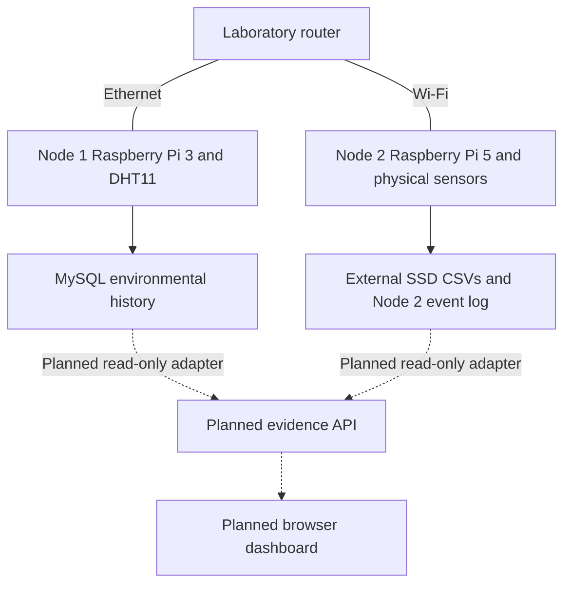

# System architecture

## Network and evidence flow

The router provides the shared laboratory network: Node 1 connects by Ethernet and Node 2 by Wi-Fi. Internet access is optional for the acquisition architecture. Data flow is from sensors into acquisition processes and then storage; it is not a serial electrical chain from the router through a sensor into a database.

Node 1: DHT11 → Raspberry Pi 3 acquisition → MySQL environmental records. The database may be local or on another host; its location must be confirmed before documenting a connection string.

Node 2: light/PIR/tamper GPIO signals and Linux USB/block-device observations → acquisition scripts → sensor CSVs and USB artifacts on the external SSD. An existing Node 2 timeline is evidenced by the supplied `event.log`, but its generator source is absent from this release.

USB monitoring concerns connected devices and block-device events; the supplied files contain no BadUSB payload. A teaching label of BadUSB on the physical setup does not establish that a malicious HID payload was executed.

## Diagrams

- `assets/diagrams/testbed-architecture.png`: GitHub README image.
- `assets/diagrams/testbed-architecture.svg`: scalable export.
- `assets/diagrams/testbed-architecture.drawio`: editable in diagrams.net, including Google Drive workflows.
- `assets/diagrams/testbed-architecture.mmd`: Mermaid source.

## Status boundaries

1. Physical laboratory implemented and used in teaching, per the project owner.
2. Partial source release: three sensor scripts and an original launcher.
3. Existing Node 2 timeline and USB evidence samples, with generator/monitor source pending.
4. Cross-node aggregation and browser dashboard planned, not implemented here.
